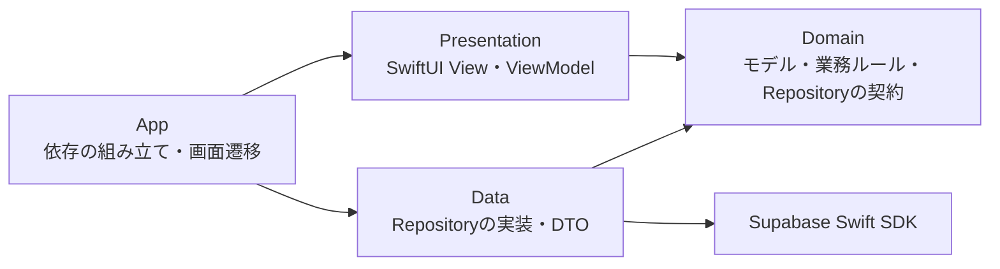
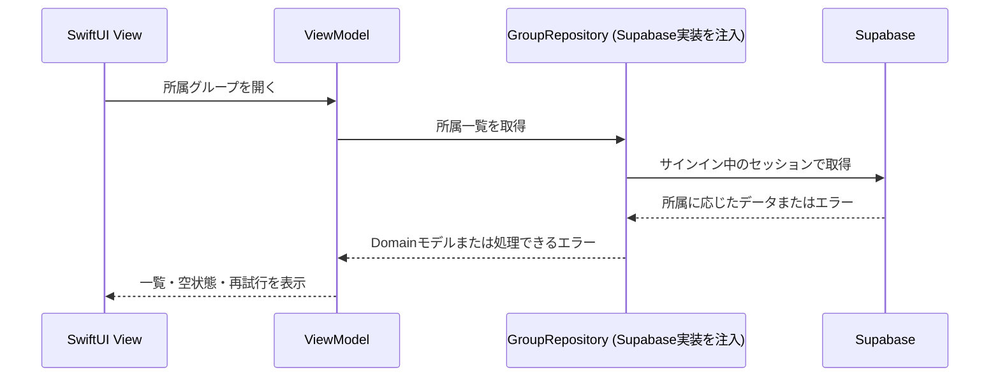

# RuuutoのiOSアーキテクチャ

iOSのコードは機能ごとにまとめる。画面はMVVMで組み、Clean Architectureの依存方向に沿って、画面、アプリのルール、Supabaseとの通信を分ける。機能の要件は [初回リリース仕様](../../spec.md)、レビュー手順は [開発ガイド](../../AGENTS.md) を参照する。

## ファイルの置き方

以下は追加先の目安。ディレクトリと型は、担当する機能で必要になった時点で作る。

```text
ios/Ruuuto/
├── App/                      起動、画面遷移、依存の組み立て
├── Features/
│   ├── Authentication/
│   ├── Groups/
│   │   ├── Presentation/     GroupDirectoryViewModel, CreateGroupViewModel
│   │   ├── Domain/           BoardGroup, GroupRepository
│   │   └── Data/             SupabaseGroupRepository, GroupDTO
│   ├── Invitations/
│   ├── Boards/
│   ├── Photos/
│   ├── History/
│   ├── Map/
│   └── Notifications/
└── Core/                     複数の機能で使う接続設定や基盤
```

## 依存方向と責務



| 層 | 責務 |
| --- | --- |
| Presentation | Viewは入力と表示を担当する。ViewModelは `@MainActor` で画面状態と非同期操作を管理し、読み込み中、空、失敗、再試行を表現する。入力途中の値やシートの開閉は、使うViewの `@State` に置く。 |
| Domain | SDKに依存しない機能のモデル、業務ルール、Repositoryの契約を置く。通信形式やSwiftUIの画面状態は外側の層で扱う。 |
| Data | Supabaseと通信し、DTOとDomainモデルを変換する。認証失効・権限拒否・競合・通信失敗などを、呼び出し側が扱える結果に変換する。 |
| AppとCore | AppでSupabaseクライアントとRepositoryを組み立て、画面が必要な依存を渡す。認証済みセッションごとにViewModelを保持し、各機能の結果を受けて遷移を扱う。Coreには、複数の機能が共有する設定や基盤を置く。 |

単純な画面はViewとローカル状態で組む。取得・保存・再試行などの状態が増える画面にはViewModelを置く。UseCaseは複数の操作を組み合わせるルールや、複数画面が使う手順をまとめる場合に追加する。

## Supabaseとの接点



Repositoryの契約はiOS側で使う操作を表す。DBのテーブル名、RPC名、Storageのパス、Realtimeのメッセージ形式はData側に置く。APIをつなぐ前に、あゆむとiOS担当で入出力、空値と時刻の意味、利用できる人、エラー、再試行時の扱いを確認し、対応するJira課題に記載する。

アプリはPublishable keyと認証済みのセッションで接続する。サーバーはRLS・Storage・Realtimeの権限や締切、同時編集の結果を確定する。グループ切替やサインアウト時は、以前のボードの取得と購読を終了し、遅れて届いた結果を破棄する。再接続時はサーバーの確定状態を取得して、画面をそろえる。 [Supabase Swift SDK](https://supabase.com/docs/reference/swift/introduction) · [RLS](https://supabase.com/docs/guides/database/postgres/row-level-security) · [Realtimeのアクセス制御](https://supabase.com/docs/guides/realtime/authorization)

招待リンクとAPNs通知はアプリの入口で形式を確認する。認証が必要なら受け取った入力を保留し、認証とグループの所属確認が済んだ時点で対象の画面を開く。

## ログイン後の処理をつなぐ

| 操作 | AppとViewで使う処理 |
| --- | --- |
| 所属一覧を開く、グループを選ぶ | 認証済みの所属取得処理を `GroupDirectoryViewModel` に渡す。各画面は同じViewModelの `selectedID` を参照する。 |
| グループを作る、招待を受ける | 作成結果と招待で参加したグループIDを共通の選択処理に渡す。 |
| ボードを開く、お題を保存する | 選択中のIDを `CurrentBoardViewModel` に渡す。保存後は `TopicEditorViewModel` から同じViewModelの `reload(for:)` を呼ぶ。 |
| 通知を開く | `NotificationSettingsViewModel` の遷移先を受け取り、対象グループへの所属を確認してからボードを開く。 |

ログイン後の状態管理とViewModelのPRは、Appや画面から呼び出す操作と、Viewに渡す状態を記載する。画面担当は [原案HTML](../design/eesu-ui-design.html) と [承認済みの4画面](https://github.com/AtsushiHosaka/Ruuuto/pull/12) を参照し、該当するViewModelに接続する。

## PRでの確認

PRに変更した層、状態の管理場所、追加または変更したRepositoryの契約を書く。Supabaseに接続する変更は、検証用環境で、正常時に加えて対象となる権限拒否や再試行も確認する。プレビューの確認と実環境での検証は、それぞれ結果を記載する。

認証では、画面状態とSupabase Authの呼び出しを分け、セッションの切替を一か所で扱う。
